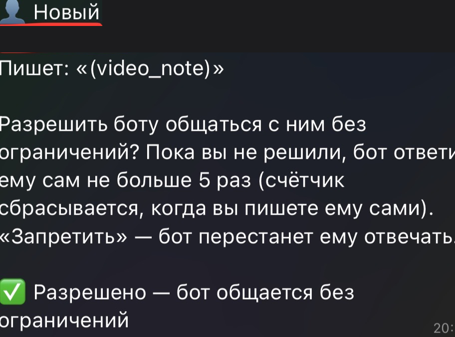

# Claude Telegram Business Bot

[Русский](README.md) · **English**

A modification of the official Telegram plugin for [Claude Code](https://claude.com/claude-code).
The bot connects to your **personal** Telegram account (Telegram Business → Chatbots) and helps
you answer people: it replies on its own to simple small talk and asks you to approve everything else.

> Unofficial project. Based on `telegram@claude-plugins-official` v0.0.7 (Apache-2.0, see `plugin/LICENSE`).
> All changes are listed below and in `patches/`.

## Features

- **Auto-replies to small talk** ("hi", "how are you", "thanks") in the owner's tone,
  using the last 30 messages of the chat as context.
- **Everything else** goes to the owner as a draft with "✅ Send / ❌ Don't send" buttons.
- **New contacts**: the bot asks the owner "Allow / Deny". Until decided, at most 5 auto-replies
  (the counter resets when the owner writes themselves). Allowed contacts: no cap. Denied: ignored.
- **Local chat history** per contact (JSONL + downloaded media).
- **Deleted message alerts**: if a contact deletes a message, the owner gets its text and media.
- **`/contacts` command** — allowed / pending / denied lists with buttons.
- Status notices: 🟢 started / 🔴 stopped / ⚠️ not receiving messages.
- Windows helpers: start Claude Code at login and on **Alt+Win+F5** (`hotkey/`).

## Screenshots

| New contact | Started | Stopped |
|---|---|---|
|  |  |  |

## Looking for feedback

This is a young project — ideas, reviews and pull requests are very welcome, see [CONTRIBUTING.md](CONTRIBUTING.md).
Especially useful:

- **security review** — the bot reads private chats, so any hole matters;
- autostart for **macOS / Linux** (Windows only for now);
- **tests** for the server logic (limits, history, drafts);
- **voice message** transcription;
- an easier way to re-apply the patch to **new plugin versions**.

> The code was written together with Claude (Claude Code). There are no automated tests yet — it has been checked by hand on one account.

## Security model

Contacts' messages are treated as **untrusted**:

- the server — not the model — decides whether a reply may skip approval:
  ≤ 200 chars, no links, @mentions, phone numbers, codes or times;
- per-contact limits plus a bot-to-bot loop guard (≥ 20 s apart, ≤ 15 per hour per chat);
- the only path to a contact without those checks is the owner's button;
- if the contact edits or deletes their message before "Send" is tapped, the reply is not sent;
- only the Claude Code session started with `--channels` receives messages.

**No personal data lives in this repository.** The bot token, owner ID, contact list, history and media
stay on the owner's machine in `~/.claude/channels/telegram/` and are excluded via `.gitignore`.
This code grants nobody access to someone else's bot or Claude subscription — you need **your own**
bot, token and subscription.

## Setup (Windows)

1. Install [Claude Code](https://claude.com/claude-code) and [Bun](https://bun.sh).
2. In Claude Code, install the official plugin and configure your bot:
   ```
   /plugin install telegram@claude-plugins-official
   /telegram:configure <token from @BotFather>
   ```
3. Replace the plugin's `server.ts` with `plugin/server.ts`
   (usually `~/.claude/plugins/cache/claude-plugins-official/telegram/0.0.7/`)
   or apply `patches/telegram-0.0.7-business.patch`.
4. In @BotFather enable **Secretary Mode** (Business Mode) for the bot.
5. Copy `config-examples/business-settings.example.json` to `~/.claude/channels/telegram/business-settings.json`.
6. Start Claude Code with the channel:
   ```
   claude --channels plugin:telegram@claude-plugins-official
   ```
   DM the bot, pair with `/telegram:access pair <code>`, then `/telegram:access policy allowlist`.
7. Telegram → Settings → Telegram Business → Chatbots → add the bot and allow "Reply to messages".
8. (Optional) autostart and Alt+Win+F5: `powershell -ExecutionPolicy Bypass -File hotkey\install.ps1`.

> Updating the official plugin overwrites `server.ts` — re-apply the patch afterwards.

## License

Apache-2.0, same as the original plugin. Changed code is marked with `[custom]` comments.
