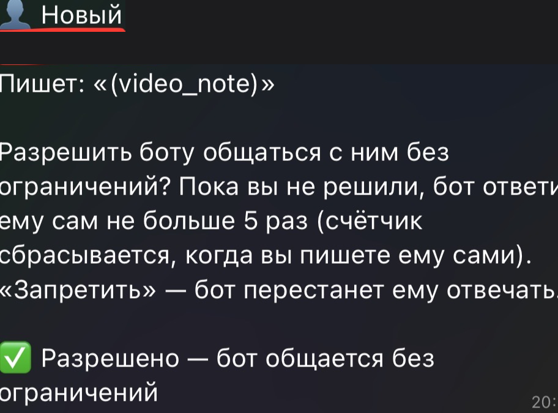
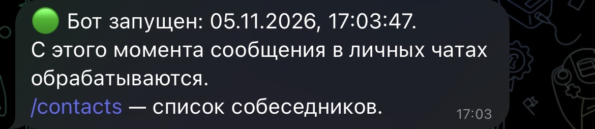

# Claude Telegram Business Bot

**Русский** · [English](README.en.md)

Доработка официального Telegram-плагина для [Claude Code](https://claude.com/claude-code):
бот подключается к личному аккаунту Telegram (Telegram Business → Чат-боты)
и помогает отвечать собеседникам — сам на простые сообщения, через подтверждение
владельца на всё остальное.

> Неофициальный проект. Основан на плагине `telegram@claude-plugins-official` версии 0.0.7
> (лицензия Apache-2.0, см. `plugin/LICENSE`). Изменения перечислены ниже и в `patches/`.

## Что умеет

- **Автоответы на простые сообщения** («привет», «как дела», «спасибо») в стиле владельца.
- **Круги общения** («Друзья», «Работа», «Семья»; человек может быть в нескольких) и короткие выжимки:
  стиль владельца, стиль каждого круга и карточка каждого собеседника. Их составляет сам бот
  (по одному чату за раз, когда переписка затихла), владелец может посмотреть и исправить их в `/circles`
  и `/contacts`. Для ответа бот берёт эти выжимки и только последние 10 сообщений чата — без перечитывания
  всей истории; если собеседник ссылается на старое, бот ищет только в этом чате.
- **Сложные сообщения** приходят владельцу в чат с ботом как черновик с кнопками
  «✅ Отправить / ❌ Не отправлять».
- **Новые собеседники**: бот спрашивает владельца «Разрешить / Запретить».
  Пока решения нет — не больше 5 автоответов (счётчик сбрасывается, когда владелец пишет сам).
  Разрешённым — без лимита, запрещённых бот игнорирует.
- **История переписки** по каждому собеседнику хранится локально (JSONL + вложения).
- **Уведомления об удалённых сообщениях** собеседника — с текстом и вложением.
- **Google Календарь**: если в переписке договорились о встрече или отменили её, бот предлагает
  добавить/убрать событие — изменение делается только после кнопки «✅» владельца
  (нужен коннектор Google Calendar в claude.ai).
- **Команда `/contacts`** — список собеседников; нажатие на человека открывает его карточку, круги и статус.
  Кнопка «📦 В архив» убирает человека из списка, сохраняя историю и карточку; если он напишет снова — вернётся.
- **Напоминания** — напишите боту «напомни завтра в 10 позвонить в банк»; `/reminders` — список.
  Хранятся в файле и не теряются при перезапуске; черновики и предложения календаря — тоже.
- **Автоочистка памяти сессии**: когда контекст Claude Code вырастает (по умолчанию ~120 тыс. токенов),
  бот в спокойный момент перезапускает сессию (`hotkey/run-bot.ps1`), чтобы каждое сообщение не тянуло
  за собой всю прошлую переписку. Порог — `memoryResetTokens` в `business-settings.json` (0 — выключить).
- **Расшифровка голосовых и кружков** — локально, моделью Whisper (`whisper/install.ps1`), голос никуда
  не отправляется. Бот понимает голосовые собеседников (и в комментариях канала), а владелец может
  давать боту команды голосом.
- **Каналы владельца** (`/channels`): добавьте бота администратором в свой канал и в его чат комментариев.
  Бот отвечает на комментарии под постами (простые — сам, остальные — черновиком владельцу,
  есть кнопка «не отвечать этому человеку»), а по просьбе владельца («опубликуй в канал: …») готовит пост
  и публикует его только после кнопки «✅ Опубликовать». Каналы, куда бота добавил не владелец, бот покидает.
- **Сводка новостей** (`/news`): раз в день бот читает новые посты публичных каналов через их веб-версию
  `t.me/s/<канал>` (вступать в канал не нужно), а Claude присылает короткую сводку без рекламы и повторов.
- **Команда `/stats`** — сколько токенов потратила сессия бота сегодня, за 7 дней и по дням.
  Данные берутся из журналов Claude Code и копятся в `usage-stats.json` / `usage-stats.csv`
  (история сохраняется, даже когда Claude Code удаляет старые журналы). Папка запуска по умолчанию —
  `~/claude-telegram`, другую можно указать в `business-settings.json` → `"usageDir"`.
- Уведомления «🟢 запущен / 🔴 остановлен / ⚠️ не получает сообщения».
- Автозапуск Claude Code с ботом при входе в Windows (через 20 секунд)
  и быстрый запуск по **Alt+Win+F5** (папка `hotkey/`).

## Как это выглядит

| Новый собеседник | Запуск | Остановка |
|---|---|---|
|  |  |  |

## Ищу помощь и советы

Проект молодой, буду рад любым идеям, ревью и пулл-реквестам — см. [CONTRIBUTING.md](CONTRIBUTING.md).
Особенно нужен взгляд со стороны на:

- **безопасность** — бот читает личные переписки, любые найденные дыры очень важны;
- автозапуск на **macOS и Linux** (сейчас только Windows);
- **тесты** для серверной логики (лимиты, история, черновики);
- удобный перенос патча на **новые версии** официального плагина.

> Код написан вместе с Claude (Claude Code). Автоматических тестов пока нет — проверено вручную на одном аккаунте.

## Безопасность

Сообщения собеседников считаются **недоверенными**:

- сервер, а не модель, решает, можно ли отправить ответ без подтверждения:
  длина ≤ 200 символов, без ссылок, @упоминаний, телефонов, кодов, времени;
- лимиты и защита от «переписки двух ботов» (не чаще раза в 20 с, не больше 15 в час на чат);
- единственный путь сообщения к собеседнику без автопроверок — кнопка владельца;
- если собеседник изменил или удалил сообщение до нажатия «Отправить», ответ не уходит;
- бот слушает сообщения только в сессии Claude Code, запущенной с `--channels`.

**В репозитории нет и не должно быть личных данных.** Токен бота, ID владельца,
список контактов, история и вложения хранятся только на компьютере владельца
в `~/.claude/channels/telegram/` и исключены через `.gitignore`.
Этот код не даёт никому доступа к чужому боту или подписке Claude:
чтобы им пользоваться, нужны **свой** бот, **свой** токен и **своя** подписка.

## Установка (Windows)

1. Установите [Claude Code](https://claude.com/claude-code) и [Bun](https://bun.sh).
2. В Claude Code установите официальный плагин и настройте свой бот:
   ```
   /plugin install telegram@claude-plugins-official
   /telegram:configure <токен от @BotFather>
   ```
3. Замените `server.ts` плагина файлом из `plugin/server.ts`
   (обычно `~/.claude/plugins/cache/claude-plugins-official/telegram/0.0.7/`)
   или примените `patches/telegram-0.0.7-business.patch`.
4. В @BotFather включите **Secretary Mode** (Business Mode) для бота.
5. Скопируйте `config-examples/business-settings.example.json`
   в `~/.claude/channels/telegram/business-settings.json`.
6. Запустите Claude Code с каналом:
   ```
   claude --channels plugin:telegram@claude-plugins-official
   ```
   Напишите боту, подтвердите пару через `/telegram:access pair <код>`,
   затем `/telegram:access policy allowlist`.
7. Telegram → Настройки → Telegram Business → Чат-боты → добавьте бота,
   разрешите «Отвечать на сообщения».
8. (По желанию) автозапуск и Alt+Win+F5: `powershell -ExecutionPolicy Bypass -File hotkey\install.ps1`.
   Задержку автозапуска можно поменять в `hotkey\claude-hotkey.ps1` (`$AutoStartDelaySec`, 0 — выключить).

> При обновлении официального плагина изменения в `server.ts` перезапишутся —
> примените патч заново.

## Структура

```
plugin/server.ts                 доработанный сервер плагина
plugin/LICENSE                   лицензия Apache-2.0 оригинального плагина
patches/                         разница с оригиналом 0.0.7
hotkey/                          автозапуск, Alt+Win+F5 и перезапуск для очистки памяти (Windows)
config-examples/                 пример настроек без личных данных
```

## Лицензия

Apache-2.0, как у оригинального плагина. Изменённые файлы помечены комментариями `[custom]`.
